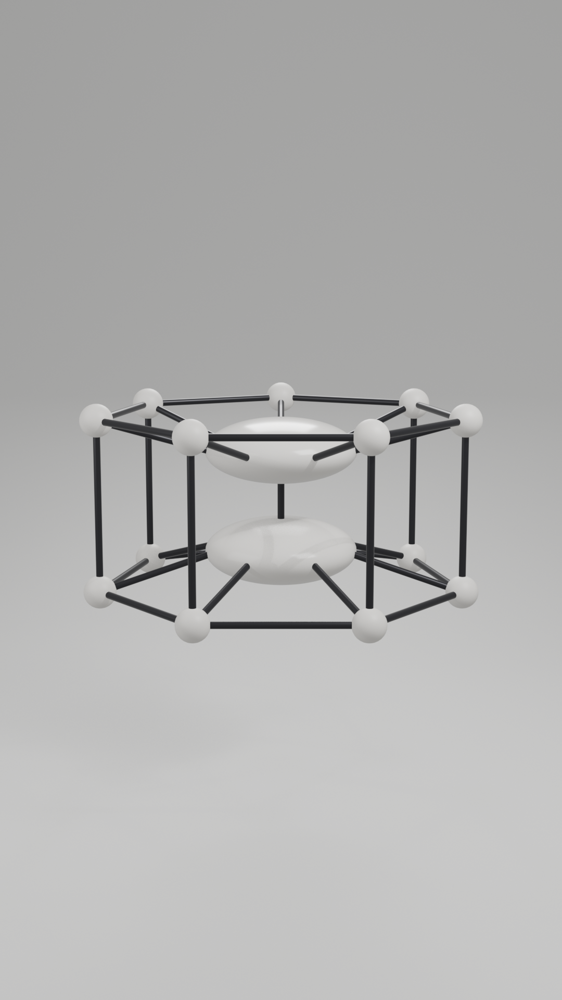

# Sketch Cage

A symmetrical cage by Hope Abeacan, built in Blender from a hand-drawn sketch.

The cage is two parallel rings of seven spheres. Each sphere is joined only to its neighbours round its ring and to the sphere directly above or below it. Between the rings sit two Smartie-shaped plates, one high and one low, each spoked to its own ring and joined to the other by a central spine.

## Files

| File | What it's for |
| --- | --- |
| `sketch_cage.blend` | The full Blender scene: model, backdrop, lights, camera, 9:16 render settings and an 8-second turntable |
| `sketch_cage.glb` | The model only, for web viewers, game engines and VR |
| `sketch_cage.fbx` | The model only, for Unity, VRChat, Sansar and other tools |
| `sketch_cage.stl` | A print-ready single mesh, scaled to about 115 mm across |
| `build_sketch_cage.py` | Rebuilds the whole scene from scratch in Blender |
| `renders/sketch_cage.png` | 1080 × 1920 render |

## Print-ready version

The `print/` folder holds a version made for 3D printing. It is a single watertight solid, about 115 × 112 × 59 mm. It has two changes from the model above: the struts are 3 mm thick, and each bottom sphere has a flat foot.

| File | What it's for |
| --- | --- |
| `print/dendera_print.3mf` | Opens directly in Bambu Studio and other slicers |
| `print/dendera_print.stl` | The same solid as an STL |
| `print/build_print_mesh.py` | Rebuilds the print solid (`pip install manifold3d trimesh`) |

On a Bambu Lab P1S, slicing with tree supports and a 5 mm outer brim gives about 2 h 41 min and 51 g of PLA.

## Dimensions

At scene scale, 1 unit = 1 m.

- **Rings:** 1.8 m radius, 1.67 m apart
- **Spheres:** 0.32 m across
- **Plates:** 1.5 m across and 0.63 m thick, 1.0 m apart
- **Struts:** 0.07 m thick
- **Overall:** about 3.8 m across and 2.0 m tall

The STL is exported at 1 m = 30 mm.

## Rebuilding or changing it

Open `build_sketch_cage.py` in Blender's Scripting tab and press **Run Script**. It builds everything into a new scene called "Sketch Cage" and leaves your other scenes alone.

All the measurements are at the top of the script. Change them and run it again to get a new version.

Made with Blender 5.2.

## Licence

Apache License 2.0. See [LICENSE](LICENSE).
